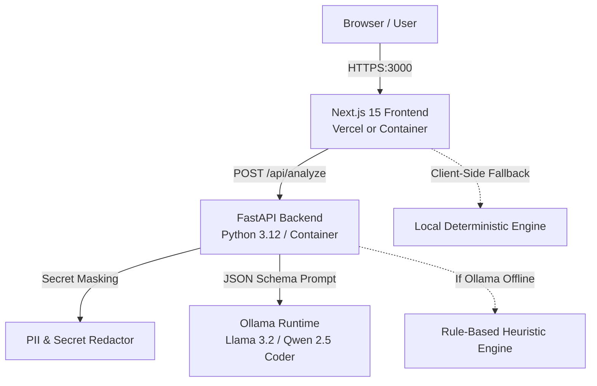

# DevFix AI — Deployment & Infrastructure Guide

This guide covers deployment procedures for **DevFix AI**, spanning local development, containerized environments, Vercel frontend hosting, and production backend deployment with Ollama open-weight AI.

---

## 1. System Architecture



---

## 2. Local Development

### Prerequisites
- Node.js 18+ (Node 20+ recommended)
- Python 3.11+
- (Optional) [Ollama](https://ollama.ai) installed locally

### Option A: Running Directly on Host

#### 1. Start the FastAPI Backend
```bash
cd backend
python -m venv .venv

# On Linux / macOS:
source .venv/bin/activate
# On Windows (PowerShell):
.venv\Scripts\Activate.ps1

pip install -r requirements.txt
uvicorn app.main:app --reload --host 0.0.0.0 --port 8000
```
Backend API will be active at: `http://localhost:8000` (API Docs: `http://localhost:8000/docs`)

#### 2. Start the Next.js Frontend
```bash
cd frontend
npm install
npm run dev
```
Frontend web application will be live at: `http://localhost:3000`

---

## 3. Local Development with Docker Compose

To spin up both frontend and backend in isolated containers:

```bash
# Start Frontend (3000) and Backend (8000)
docker compose up --build
```

### With Bundled Ollama Service
To run Ollama alongside the stack in a Docker container:
```bash
docker compose --profile with-ollama up --build
```
Once started, pull the open-weight model inside the container:
```bash
docker exec -it devfix-ollama ollama run llama3.2:3b
```

---

## 4. Deploying Frontend to Vercel

DevFix AI frontend is designed to be **100% Vercel-ready** with zero build configuration required.

### Steps:
1. Push your repository to GitHub / GitLab.
2. Log into [Vercel](https://vercel.com) and click **Add New Project**.
3. Select the repository.
4. In **Root Directory**, select `frontend`.
5. Under **Environment Variables**, add:
   ```env
   NEXT_PUBLIC_BACKEND_URL=https://your-backend-domain.com
   ```
   *(If left empty or if the backend is down, the frontend automatically falls back to the client-side deterministic demo engine!)*
6. Click **Deploy**.

---

## 5. Deploying FastAPI Backend to Production

You can deploy the backend to Render, Railway, Fly.io, or an Ubuntu VPS.

### Deploying with Docker (Any VPS / Cloud)
```bash
cd backend
docker build -t devfix-backend:latest .
docker run -d \
  --name devfix-backend \
  -p 8000:8000 \
  -e OLLAMA_BASE_URL="http://your-ollama-host:11434" \
  -e DEFAULT_MODEL="llama3.2:3b" \
  -e AUTO_DEMO_FALLBACK="true" \
  --restart unless-stopped \
  devfix-backend:latest
```

### Deploying to Render.com
1. Create a **New Web Service**.
2. Connect your repository.
3. Set **Root Directory** to `backend`.
4. Set **Runtime** to `Python 3`.
5. **Build Command:** `pip install -r requirements.txt`
6. **Start Command:** `uvicorn app.main:app --host 0.0.0.0 --port $PORT`
7. Set Environment Variables:
   - `OLLAMA_BASE_URL`: your Ollama server URL (or leave default for demo mode).
   - `AUTO_DEMO_FALLBACK`: `true`.

---

## 6. Hosting Ollama for Production / Small Teams

For small IT teams, running Ollama on an internal GPU server or cloud instance (e.g., AWS EC2 `g5.xlarge` or Hetzner GPU) ensures **zero data exfiltration** and **zero per-token charges**.

### Ubuntu Systemd Configuration for Ollama
1. Install Ollama:
   ```bash
   curl -fsSL https://ollama.ai/install.sh | sh
   ```
2. Configure Ollama to bind to all interfaces:
   Edit `/etc/systemd/system/ollama.service.d/override.conf`:
   ```ini
   [Service]
   Environment="OLLAMA_HOST=0.0.0.0:11434"
   Environment="OLLAMA_ORIGINS=*"
   ```
3. Reload and restart:
   ```bash
   sudo systemctl daemon-reload
   sudo systemctl restart ollama
   ```
4. Pull the recommended open-weight models:
   ```bash
   ollama pull llama3.2:3b
   ollama pull qwen2.5-coder:7b
   ```
5. Point DevFix AI backend to:
   ```env
   OLLAMA_BASE_URL=http://<private-server-ip>:11434
   DEFAULT_MODEL=qwen2.5-coder:7b
   ```

---

## 7. Verifying Deployment Health

Check system endpoints:
```bash
# Backend health
curl -f http://localhost:8000/api/health

# Ollama connection and installed models status
curl -f http://localhost:8000/api/models/status

# Curated sample errors
curl -f http://localhost:8000/api/samples
```
