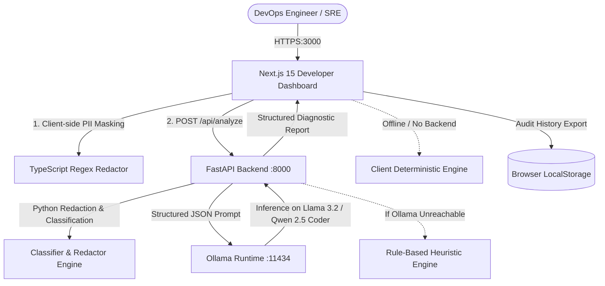

<div align="center">

# 🛠️ DevFix AI

### **AI-Powered DevOps & SRE Troubleshooting Assistant**
#### *Diagnose Infrastructure Errors with Open-Weight AI (Ollama) — 100% Private, Air-Gapped Ready & $0 Cloud Token Fees*

[](https://d-evfix-ai-12ck-nu.vercel.app/)

[](https://opensource.org/licenses/MIT)
[](https://fastapi.tiangolo.com)
[](https://python.org)
[](https://nextjs.org)
[](https://tailwindcss.com)
[](https://ollama.ai)
[](https://docker.com)

🚀 **[Try the Live Web App on Vercel](https://d-evfix-ai-12ck-nu.vercel.app/)**

[Explore Features](#-key-features) • [Quickstart](#-quickstart) • [Architecture](#-architecture) • [Supported Platforms](#-supported-platforms--samples) • [Deployment](#-deployment) • [Contributing](#-contributing)

</div>

---

## 📌 Why DevFix AI?

Modern DevOps teams face a difficult dilemma during incidents:
1. **Proprietary Cloud AI APIs (OpenAI, Claude):** While smart, sending infrastructure logs to external APIs exposes sensitive internal hostnames, private IP subnets, database credentials, and trace IDs to third-party data centers. Furthermore, verbose multi-thousand-line crash logs result in unpredictable, exorbitant monthly token bills.
2. **Traditional Search & Static Playbooks:** Slow, fragmented across scattered documentation, and hard to correlate with real-time stack traces.

**DevFix AI** solves this by running precision DevOps troubleshooting over **open-weight AI models** (such as Meta's `llama3.2:3b`, Alibaba's `qwen2.5-coder:7b`, or Mistral) hosted locally or in your private VPC using **Ollama**.

- 🔒 **Zero Data Exfiltration:** Your logs stay on your machine or private VPC.
- 💸 **Zero Per-Token Bills:** No surprise cloud charges—unlimited queries on local hardware.
- 🛡️ **Human-in-the-Loop Safety:** Suggested diagnostic commands are clearly categorized (Read-Only vs Elevated) and **never auto-executed**.
- ⚡ **Offline Resilience:** Functions even during internet or cloud provider outages with built-in deterministic demo intelligence.

---

## 🚀 Key Features

| Feature | Description |
| :--- | :--- |
| **🖥️ Modern Developer Dashboard** | Built with Next.js 15, TypeScript, Tailwind CSS v4, and Lucide icons in a sleek dark developer aesthetic (`#030712`). |
| **🔍 Multi-Platform Ingestion** | Ingests and parses errors from **Kubernetes**, **Docker**, **Jenkins**, **Linux / Systemd**, **Terraform**, and **AWS Cloud**. |
| **🏷️ Auto-Tech & Category Detection** | Classifies failure modes into `ResourceExhaustion`, `Networking`, `PermissionDenied`, `StateLock`, `ServiceCrash`, and `ConfigurationError`. |
| **📊 Structured Diagnostic Reports** | Generates executive summaries, root cause explanations, direct log evidence citations, confidence scores, and remediation steps. |
| **💻 Safe Terminal Commands** | Provides copyable, safe read-only terminal diagnostic commands with expected output benchmarks. |
| **⚠️ Rollback Precautions** | Suggests preventative precautions and rollback commands for each remediation to avoid secondary cascading outages. |
| **🛡️ Secret & PII Auto-Redaction** | One-click masking of AWS access keys (`AKIA...`), database credentials, GitHub tokens (`ghp_...`), JWTs, and IPv4 addresses before analysis. |
| **🌐 Local vs Remote Privacy Badge** | Live indicator showing whether inference is `Local Air-Gapped AI`, `Remote Ollama Server`, or `Deterministic Demo Engine`. |
| **🧪 Interactive Sample Library** | 6 pre-loaded real-world failure scenarios for instant testing and demonstration without configuration. |
| **📜 Local Browser Audit History** | Persists past diagnostic audits in browser `localStorage` with search, platform filters, severity filters, and JSON export. |
| **🔌 Ollama Model Configurator** | Live endpoint connection tester, 3-step setup guide, and comparison table for open-weight models. |
| **💎 Transparent Pricing Page** | Proposed developer tiers ($0 Community, $19 Team Pro, Custom Air-Gapped) with zero fake billing. |

---

## 🏗️ Architecture



---

## 📦 Supported Platforms & Samples

DevFix AI includes curated real-world failure scenarios ready to test immediately:

| Platform | Scenario | Failure Mode | Key Indicators |
| :--- | :--- | :--- | :--- |
| **Kubernetes** | Microservice CrashLoopBackOff | `ResourceExhaustion` | JVM Heap OutOfMemory, `ExitCode 137`, cgroup limit `512Mi` |
| **Docker** | Userland Proxy Bind Failure | `Networking` | Socket bind collision `listen tcp4 0.0.0.0:8080: address already in use` |
| **Jenkins** | CI Pipeline Webpack/Vite Crash | `BuildFailure` | `JavaScript heap out of memory`, V8 2GB limit reached |
| **Linux** | Systemd Nginx Startup Failure | `ServiceCrash` | SSL certificate `fopen: Permission denied` (code=exited, status=1) |
| **Terraform** | AWS DynamoDB State Lock | `StateLock` | Remote backend lock conflict `ConditionalCheckFailedException` |
| **AWS Cloud** | S3 KMS Encrypted Upload Denied | `PermissionDenied` | `AccessDenied` (403) missing `kms:GenerateDataKey` on IAM role |

---

## ⚡ Quickstart

### Option 1: Docker Compose (Recommended)

Clone the repository and spin up the full stack with a single command:

```bash
git clone https://github.com/MdFaisalDevops/DEvfix-Ai.git
cd DEvfix-Ai

# Start Frontend (3000) and Backend (8000)
docker compose up --build
```

- **Frontend Dashboard:** [http://localhost:3000](http://localhost:3000)
- **FastAPI Interactive Docs (Swagger):** [http://localhost:8000/docs](http://localhost:8000/docs)
- **Backend Health Check:** [http://localhost:8000/api/health](http://localhost:8000/api/health)

#### Running with a Containerized Ollama Instance:
```bash
docker compose --profile with-ollama up --build
```
Then pull your chosen open-weight model:
```bash
docker exec -it devfix-ollama ollama run llama3.2:3b
```

---

### Option 2: Local Development Setup

#### 1. Backend (FastAPI + Python 3.12)
```bash
cd backend

# Create and activate virtual environment
python -m venv .venv

# On Linux / macOS:
source .venv/bin/activate
# On Windows (PowerShell):
.venv\Scripts\Activate.ps1

# Install dependencies
pip install -r requirements.txt

# Run backend development server
uvicorn app.main:app --reload --host 0.0.0.0 --port 8000
```

#### 2. Frontend (Next.js 15 + TypeScript)
```bash
cd frontend

# Install dependencies
npm install

# Run frontend development server
npm run dev
```

Visit [http://localhost:3000](http://localhost:3000) to access the dashboard.

---

## 🤖 Recommended Open-Weight Models

DevFix AI is optimized for open-weight models running via [Ollama](https://ollama.ai):

| Model | Download Command | Parameters | RAM Required | Best Used For |
| :--- | :--- | :--- | :--- | :--- |
| **Llama 3.2** | `ollama run llama3.2:3b` | 3B | ~4 GB | Ultra-fast triage on standard developer laptops |
| **Qwen 2.5 Coder** | `ollama run qwen2.5-coder:7b` | 7B | ~8 GB | Specialized DevOps, Bash scripting, and YAML debugging |
| **Mistral** | `ollama run mistral:7b` | 7B | ~8 GB | Solid reasoning across Linux system errors & Terraform state |
| **DeepSeek R1** | `ollama run deepseek-r1:7b` | 7B | ~8 GB | Chain-of-thought analysis for complex multi-tier outages |

---

## 🧪 Testing

### Backend Unit Tests (Pytest)
```bash
cd backend
pytest tests -v
```
*Validates the regex secret redactor, classifier logic, deterministic fallback engine, and FastAPI endpoints (10/10 tests pass).*

### Frontend Production Build
```bash
cd frontend
npm run build
```
*Compiles the Next.js production build and checks TypeScript types.*

---

## 🌐 Deployment Guide

### Deploying Frontend to Vercel
1. Fork or push this repository to GitHub.
2. Import the repository in [Vercel](https://vercel.com).
3. Set **Root Directory** to `frontend`.
4. Add environment variable:
   ```env
   NEXT_PUBLIC_BACKEND_URL=https://your-backend-api.com
   ```
   *(Note: If left empty, DevFix AI's client-side deterministic engine will still function 100% in demo mode!)*
5. Click **Deploy**.

For detailed production backend deployments (Docker, Render, Fly.io, AWS EC2 GPU instances), check out [DEPLOYMENT.md](DEPLOYMENT.md).

---

## 🔒 Security & Privacy Philosophy

1. **Zero External Telemetry:** Raw logs analyzed with local Ollama are never sent to external servers.
2. **Client-Side Secret Redaction:** API keys, tokens, database URIs, and IPs are scrubbed before inference.
3. **Never Auto-Executes Commands:** Remediation commands are presented for engineer inspection and require deliberate manual execution.

---

## 🤝 Contributing

Contributions, issues, and feature requests are welcome!
1. Fork the Project.
2. Create your Feature Branch (`git checkout -b feature/AmazingFeature`).
3. Commit your Changes (`git commit -m 'Add some AmazingFeature'`).
4. Push to the Branch (`git push origin feature/AmazingFeature`).
5. Open a Pull Request.

---

## 📄 License

Distributed under the MIT License. See [LICENSE](LICENSE) for more information.

---

<div align="center">
  <sub>Built with ❤️ for DevOps engineers and SREs worldwide.</sub>
</div>
